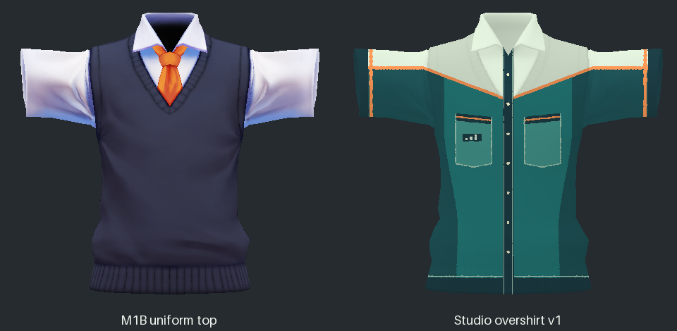

# 海松青拼肩短袖工作衫

上衣 ID 为 `shared-male-studio-top-v1`，版本 1。成品为 290,240 字节的单一自包含 GLB，SHA-256 为 `7f1e8fafa3f22a73b1417dd7d2585949a560257f6a6643b9f135083c6e1522c2`。

## 款式与制作源

新款沿用 M1B 男制服的短袖、有领衣片和蒙皮。制作脚本裁去独立领带，将袖口向外延伸 10 毫米，下摆逐渐向外放量，并按衣体坐标绘制深青衣身、浅色拼肩、橙色滚边、胸袋图案、设备标、袖口及揿扣门襟。袋、标和扣为贴图细节。材质沿用项目的无光照不透明外观，1024 像素底色纹理嵌在成品内。代码与配方即本款可编辑制作源。



几何、三角形、原 UV、关节、权重及逆绑定矩阵来自 `prototype/public/assets/m1b/m1b-uniform-top.glb` 的首个 primitive。此母件来自 M1B 重导身体的节点 67 `Body`、网格 0 `Body.baked`、皮肤 0、衣物 primitive 1、材质 1。其领带在 primitive 2。原发布者 VRM 中同源衣片的编号不同，见配方中两套选择器。项目 1K 旧制服仅供少量布面明暗调制；绘制的图案与配色由本款脚本生成。

上游为 hecko 发布的 VRoid Project 旧版男体，工程内保存有发布者页面、当时源件与旧版适用条件。权属依据与限制沿用 [存档声明](../foundation-male/LICENSE.md) 和 [原始取得回执](../foundation-male/source.json)。M1B 编辑工程与从该原件重导、拆出上衣的步骤在 [M1B 制作记录](../m1b/README.md)。本件沿用上述原件范围；整套产品的发行审核另行记录。

## 重建与回读

在本机使用 Python、NumPy 2.4.2、SciPy 1.18.1 和 Pillow 12.1.0。以下命令可从任意工作目录运行。脚本将输出固定在制作主工程的本款目录，逐项检查输入 SHA，保留已有且一致的结果，遇到不同字节会报错。

```powershell
python -B F:/gamemake/assets-source/shared-male-studio-top-v1/build.py
python -B F:/gamemake/assets-source/shared-male-studio-top-v1/build.py --check
```

[回读回执](receipt.json) 记录 1,399 个顶点、2,004 个三角形。381 行顶点位置发生变化，最大位移 10 毫米。UV、三角形索引、蒙皮权重和骨索引与母衣片逐行一致。全部 10 根原始骨的逆绑定矩阵与 M1B 身体、本次母衣、原 M1B 装备清单逐项相等。原始人体表面、发型和下装独立。

制作匹配的身体 SHA-256 为 `62b44b0372570a821695d236cd412ddf902b6f683023e13fef7293de9c0b35ff`。装备按 `top` 替换原生上衣和领带，使用原始骨名及恒等静止矩阵。CPU 核查包括正面材质和本款几何；两名既有角色的游戏装备、动作、关闭和恢复由游戏接入验证。
